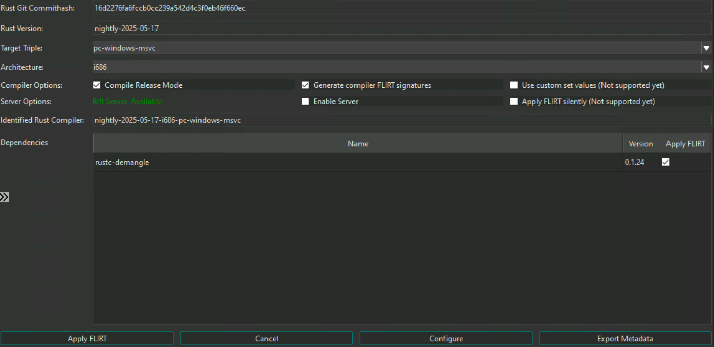

# RIFT (Rust Interactive Function Tool)

> ⚠️ **Security Warning**
>
> This tool is intended to be used **only within a dedicated virtual machine (VM)** environment. Running it outside of a controlled VM may expose your system to security risks, including potential malware execution or data leakage.
>
> Please ensure all analysis is conducted in an **isolated, sandboxed VM** with no access to production networks or sensitive data.

> 🧪 **Experimental Build**
>
> This branch is under active development. Functionality may be incomplete or subject to change. **The FLIRT path has been tested on Windows only.** Behaviour on Linux or macOS is untested and not guaranteed. The Ghidra Function ID path is newly added and has not yet been validated against a real toolchain build.

RIFT (Rust Interactive Function Tool) is a toolsuite to assist reverse engineers in identifying library code in rust malware. It is a research project developed by the MIRAGE Team, explores library recognition techniques conducted on rust binaries and was presented at RECON 2025.

This branch is an updated version, generating signatures for **both IDA Pro and Ghidra**: FLIRT
signatures (`.sig`) and Ghidra Function ID databases (`.fidb`). Pick either or both per run with the
`--flirt` and `--fidb` flags. Neither disassembler is mandatory — IDA's `pcf`/`sigmake` are needed
only for FLIRT output, a Ghidra installation only for Function ID output.

For the original version presented at RECON 2025 and also supports BinaryDiffing, see the version_1_stable(https://github.com/microsoft/RIFT/tree/version_1_stable) build.


## Features


- **Binary Metadata Extraction**: Extract metadata from Rust binaries including:
  - Rust compiler version and commit hash
  - Target architecture and triple
  - Compiler type (MSVC, GNU, UEFI)
  - Detected Rust crates and their versions
  - File type detection (PE/ELF)

- **FLIRT Signature Generation**: Create FLIRT signatures (`.sig`, IDA Pro) for:
  - Rust compiler toolchain (rustc)
  - Individual Rust crates
  - Multiple architectures, tested only on x86 and x86_64

- **Function ID Generation**: Create Function ID databases (`.fidb`, Ghidra) for the same targets,
  driven by Ghidra's `analyzeHeadless`. Requires a Ghidra installation and a JDK, but no IDA Pro.

- **Multiple Operating Modes**:
  - File analysis mode (run rift_cli.py directly on binaries)
  - JSON configuration mode (feed exported JSON files as input, similar as in version_1_stable)
  - Direct generation mode (specific crate/compiler combinations)

- **Integration in Ida**:
  - Ida Pro Plugin and RIFT_API server to generate FLIRT signature in single RE sessions

- **Integration in Ghidra**:
  - `scripts/RiftApplyFidFromFolder.java` attaches a folder of generated `.fidb` files and
    re-applies Function ID matching to the open program

## Installation

1. Clone the repository
2. Install dependencies via `py -m pip install -r requirements.txt`
3. Ensure that rustup and cargo are installed, preferably via: https://rustup.rs/
4. Place Ida Pro utilities (`pcf`, `sigmake`) and `strings.exe` from preferably SysInternals Suite in the `bin/` directory
5. For Function ID (`.fidb`) output, install Ghidra and a JDK, and set `AnalyzeHeadlessPath` in the config to the `analyzeHeadless` launcher inside Ghidra's `support/` folder
6. Configure `rift_config.cfg` with correct paths

IDA and Ghidra are both optional, but at least one is required to generate signatures. `pcf` and
`sigmake` are only needed for `--flirt`, `AnalyzeHeadlessPath` only for `--fidb`. RIFT still extracts
metadata (`--only-meta`) with neither installed.

Furthermore, RIFT depends on `data/rustc_hashes.json` to determine the rust version of the corresponding commit hash. This file should be updated regularily.

To update the `rustc_hashes.json` file, one can simply always pull the latest RIFT version or generate it by themselves via running `update_rustc_hashes.ps1` or `update_rustc_hashes.sh`, depending on the environment.


## Usage

RIFT can either run as a command line application to generate signatures on demand or as an API server appliance, communicating with an Ida Pro Plugin directly. Both modes emit FLIRT signatures (`.sig`) for IDA Pro, Function ID databases (`.fidb`) for Ghidra, or both at once.


### CommandLine Mode

| Argument | Short | Description | Default |
|----------|-------|-------------|---------|
| `--file` | `-f` | Path to binary file to analyze | - |
| `--json` | - | Input JSON configuration file | - |
| `--cfg` | `-c` | Path to config file | `./rift_config.cfg` |
| `--log` | `-l` | Log file path | None |
| `--verbose` | `-v` | Enable verbose logging | False |
| `--output` | `-o` | Output folder for signatures | `./Output` |
| `--only-meta` | - | Print metadata only (file mode) | False |
| `--flirt` | - | Generate FLIRT signatures (`.sig`, IDA Pro) | False |
| `--fidb` | - | Generate Function ID databases (`.fidb`, Ghidra) | False |

The two output flags combine: passing both generates both artifacts from a single cargo build.
Passing neither generates FLIRT signatures, so existing commands keep working unchanged.

#### File Analysis Mode

Run `rift_cli.py` directly on a binary and extract metadata or generate signatures on demand:

```bash
python rift_cli.py -f sample.exe --only-meta
```

Analyze a binary and generate FLIRT signatures:
```bash
python rift_cli.py -f sample.exe -o ./output
```

#### JSON Configuration Mode

Input a JSON configuration and generate FLIRT signatures as configured in JSON:
```bash
python rift_cli.py --json config.json -o ./output
```

#### Direct Generation Mode

Input either a crate and a compiler or simply a compiler toolchain:

Generate FLIRT for a specific crate and compiler:
```bash
python rift_cli.py reqwest@0.11.0 1.75.0-x86_64-pc-windows-msvc -o ./output
```

Generate FLIRT for a compiler toolchain only:
```bash
python rift_cli.py 1.75.0-x86_64-pc-windows-msvc -o ./output
```

Generate a Ghidra Function ID database instead of FLIRT signatures:
```bash
python rift_cli.py --fidb 1.75.0-x86_64-pc-windows-msvc -o ./output
```

Generate both artifacts from one build:
```bash
python rift_cli.py --flirt --fidb reqwest@0.11.0 1.75.0-x86_64-pc-windows-msvc -o ./output
```

### Server Mode

RIFT includes a lightweight HTTP API server (`rift_server.py`) that accepts signature generation jobs from remote clients (e.g. the IDA Pro plugin) and processes them asynchronously in the background. Clients select FLIRT, Function ID or both per request.

> **Note:** Function ID (`.fidb`) generation has not been tested in server mode so far. It has only been validated through `rift_cli.py`.

#### Starting the server

```bash
python rift_server.py -o ./Output --cfg rift_config.cfg
```

| Argument | Description | Default |
|----------|-------------|---------|
| `-o` | Output folder for generated signatures. **When set, overrides any `output_folder` value sent by the client.** | `./Output/` |
| `--cfg` | Path to `rift_config.cfg` | `./rift_config.cfg` |
| `--log` | Log file path | None (stdout only) |
| `--verbose` | Enable DEBUG-level logging | False |

The server binds to the IP and port configured in `rift_config.cfg` under `[RiftServer]` (`Ip` and `Port`). Default is `127.0.0.1:5001`.

#### API Endpoints

| Method | Path | Description |
|--------|------|-------------|
| `POST` | `/flirt` | Submit a signature generation job. Returns a `job_id` immediately. |
| `POST` | `/signatures` | Format-neutral alias of `/flirt`, identical behaviour. |
| `GET` | `/job?id=<job_id>` | Get the status and result of a specific job. |
| `GET` | `/jobs[?status=<status>]` | List all jobs, optionally filtered by status (`pending`, `running`, `completed`, `failed`). |
| `GET` | `/health` | Health check — returns server status and worker state. |

#### POST /flirt — Request body

```json
{
  "commithash": "a55dd71",
  "arch": "x86_64",
  "filetype": "PE",
  "crates": [{"name": "reqwest", "version": "0.11.0"}],
  "target_triple": "x86_64-pc-windows-msvc",
  "output_folder": "/optional/client/path",
  "flirt": true,
  "fidb": false
}
```

> **Note:** `output_folder` in the request body is ignored when the server is started with `-o`.

The optional `flirt` and `fidb` booleans mirror the CLI flags and combine the same way. A request
that sets neither gets FLIRT signatures, which is what the shipped IDA plugin sends. Requesting a
format the server has no toolchain for is rejected at submission time rather than failing the job.

#### GET /job — Response example

```json
{
  "job_id": "abc123",
  "status": "completed",
  "result_files": ["/path/to/output/reqwest-0.11.0-1.75.0-x86_64-pc-windows-msvc.sig"]
}
```

### IDA Pro Integration



The RIFT IDA Pro plugin allows FLIRT signatures to be generated and optionally applied directly from within an active reverse engineering session, without leaving IDA Pro.

#### Prerequisites

- RIFT server running and reachable (see [Server Mode](#server-mode))
- IDA Pro with Python support (IDA 7.x+)
- `rift_config.cfg` configured with the correct server IP and port

#### Installation

Run the installer script, passing the path to your IDA Pro plugins folder:

```bat
installUpdateIdaPlugin.bat "%APPDATA%\Hex-Rays\IDA Pro\plugins"
```

This copies the following layout into your plugins folder:

```
plugins/
├── rift_plugin.py          ← IDA plugin entry point
├── librift_ida/
│   ├── rift_form.py        ← Plugin UI (PySide6)
│   ├── rift_ida_core.py    ← Core logic (arch detection, server comms)
│   └── rift_controller.py  ← Background thread controller
├── librift/                ← Shared RIFT core library
└── rift_essentials/
    └── rift_config.cfg     ← Server connection config
```

#### Configuration

Edit `rift_essentials/rift_config.cfg` in the plugins folder and set the server address:

```ini
[RiftServer]
Ip = 127.0.0.1
Port = 5001
```

#### Usage

1. Open a Rust binary in IDA Pro.
2. Go to **Edit → Plugins → RIFT** (or use the hotkey if configured).
3. The plugin automatically extracts metadata from the binary (compiler version, crates, architecture, target triple).
4. Click **Configure** to verify server connectivity.
5. Click **Apply** to submit a job to the RIFT server and select a local folder where signatures will be stored.
6. Generated `.sig` files can be applied to the database via IDA's signature manager or the `ida_apply_flirt_from_folder.py` script in the `scripts/` folder.
### Ghidra Integration

Ghidra consumes RIFT output as Function ID databases (`.fidb`). There is no Ghidra plugin: RIFT
generates the databases on the host, and a bundled script attaches them to your project.

For the full configuration reference, re-running Function ID matching and troubleshooting, see the
[Ghidra usage guide](docs/ghidra_usage_guide.md).

#### Prerequisites

- A Ghidra installation and a JDK matching that Ghidra version
- `AnalyzeHeadlessPath` in `rift_config.cfg` pointing at the launcher, e.g.
  `/path/to/ghidra/support/analyzeHeadless` (`analyzeHeadless.bat` on Windows)

RIFT builds each database by invoking `analyzeHeadless` twice against one throwaway project: once to
import and analyze the extracted object files, and once to run `scripts/RiftPopulateFid.java`, which
populates the database. The project is created under the configured `WorkFolder` and deleted
afterwards.

#### Generating databases

```bash
python rift_cli.py --fidb -f sample.exe -o ./output
```

Each crate and the toolchain produce one `.fidb` holding a single Function ID library, named after
the crate, its version and the toolchain:

```
rustc-1.75.0-x86_64-pc-windows-msvc.fidb
reqwest-0.11.0-1.75.0-x86_64-pc-windows-msvc.fidb
```

#### Applying databases

1. Copy `scripts/RiftApplyFidFromFolder.java` into your Ghidra scripts directory (by default
   `~/ghidra_scripts`), or add `scripts/` as a script path in the Script Manager.
2. Open the Rust binary in Ghidra and run **RiftApplyFidFromFolder** from the Script Manager.
3. Select the folder containing the generated `.fidb` files. The script attaches every database in
   it and re-applies Function ID matching to the open program.

Attached databases persist in your Ghidra configuration, so subsequent programs are matched
automatically by the Function ID analyzer. They can be managed under
**Tools → Function ID → Choose active FidDbs**.
